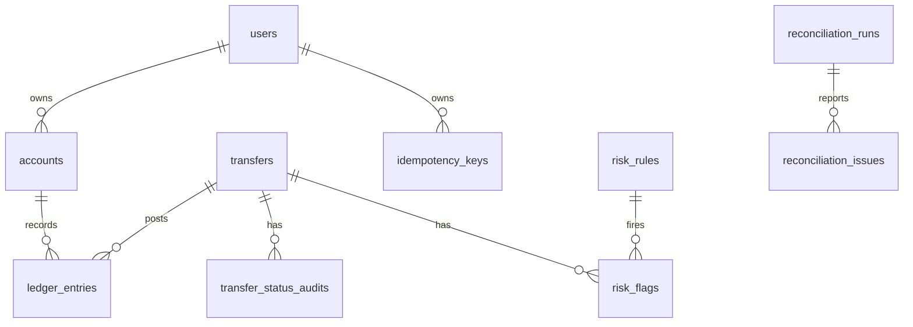

# Schema and accounting model

The persistent nouns are users, accounts, transfers, ledger entries, idempotency keys, risk rules and flags, status audits, reconciliation runs/issues, and job locks. `accounts` holds both customer wallets and system accounts: this gives every ledger line one account foreign key and makes a transfer a simple balanced debit/credit pair. User-controlled email and phone are unique business attributes, not identifiers.

All money is integer paise. Each posted transfer has a positive debit and matching positive credit; balances are transactionally maintained cached projections, while immutable `ledger_entries` are the source of truth. Foreign keys, enum-like checks, a user-wallet non-negative trigger, immutable-ledger trigger, unique idempotency key, and deferred balanced-transfer triggers provide database enforcement. The main statement index is `ledger_entries(account_id, created_at DESC, id DESC)`.

`transfers.source_account_id` and `destination_account_id` describe the business movement. A reversal is a new transfer and never changes historic rows; the existing partial unique index allows at most one reversal per original transfer.
